<div align="center">

# xsat

**A CDCL SAT solver in safe Rust: a function-for-function port of Kissat 4.0.4, plus incremental solving, checked proofs and external propagators.**

[](Cargo.toml)
[](Cargo.toml)
[](https://github.com/arminbiere/kissat)
[](#-license)

</div>

xsat solves Boolean satisfiability problems in DIMACS CNF, as a command line tool or as a Rust library. On its default configuration it runs the same search as Kissat 4.0.4: the same answer, the same conflict, decision and propagation counts, and a byte-identical DRAT proof on every file we compare. On top of that port it adds what Kissat does not have: assumptions with failed-literal cores, adding clauses between solves, IDRUP proofs for incremental sessions, an external propagator interface, Gaussian elimination over XOR constraints, and a deterministic parallel portfolio. The crate forbids `unsafe` code.

It is for people who want Kissat's search from Rust, need an incremental solver whose answers can be checked, or want to plug their own theory propagator into a CDCL loop.

## 🚀 Quickstart

```sh
cargo build --release
./target/release/xsat tests/corpus/r3_n50_s1.cnf
```

It prints `s SATISFIABLE` or `s UNSATISFIABLE`, the model in `v` lines when satisfiable, and statistics as `c` comment lines; the exit code is 10 or 20, as with Kissat. Add a second file name to write a DRAT proof:

```sh
./target/release/xsat -q tests/corpus/r3_n50_s1.cnf proof.drat
```

## ✨ What it does

| Area | What you get |
|---|---|
| Search | Kissat 4.0.4's CDCL loop: focused and stable modes, VMTF and score heap, restarts, reduction, rephasing, target and best phases, chronological backtracking, warmup, local search walks |
| Simplification | probing, backbone, transitive reduction, equivalent literal substitution, vivification, kitten-based sweeping, congruence closure, bounded variable addition (factor), bounded variable elimination with forward subsumption and gate extraction |
| Proofs | DRAT (binary and ASCII) byte-identical to Kissat's; IDRUP for incremental sessions; LRAT through `drat-trim -L` |
| Incremental | `solve_assuming` with a failed-literal `core`, `freeze` and `melt`, clauses added after a solve with eliminated clauses restored |
| Extensions | the `Propagator` trait for external theories, `Gauss` for XOR constraints, `Terminator` to stop a solve from another thread |
| Parallel | `--workers=N`: diversified workers in epochs with root units shared at barriers; for a given input and worker count the answer and the model are always the same |
| CLI | Kissat's options (all 154), `--sat` `--unsat` `--plain` `--basic` configurations, `--conflicts=`, `--decisions=`, `--time=`, compressed input through `gzip`, `bzip2`, `xz`, `lzma` and `7z` |

## 📦 Installation

xsat is not on crates.io yet. Build it from source with Rust 1.85 or newer:

```sh
git clone https://github.com/orkait/xsat.git
cd xsat
cargo build --release
```

This builds `target/release/xsat` (the solver) and `target/release/xsat-dev` (the test harness described below). To use the library from another crate, depend on it by path or git:

```toml
[dependencies]
xsat = { git = "https://github.com/orkait/xsat.git" }
```

## 🧩 Usage

### Command line

```sh
xsat [ <option> ... ] [ <dimacs> [ <proof> ] ]
```

| Option | Effect |
|---|---|
| `-q` | no comment lines |
| `-n` | do not print the model |
| `-s` | print complete statistics |
| `--sat`, `--unsat`, `--plain`, `--basic` | Kissat's configurations |
| `--<option>=<value>` | any Kissat option, for example `--eliminate=0`; `xsat --help` lists them with ranges |
| `--conflicts=<n>`, `--decisions=<n>`, `--time=<seconds>` | stop with `s UNKNOWN` at a limit |
| `--no-binary` | ASCII DRAT instead of binary |
| `--workers=<n>` | deterministic portfolio of `n` solvers |
| `--relaxed`, `--strict` | DIMACS parsing mode |
| `-f` | allow a proof file name that looks like a CNF file |

### Library

```rust
use xsat::{error::SolverError, options::Options, Solver};

fn main() -> Result<(), SolverError> {
    let mut solver = Solver::new(Options::default());
    for clause in [[1, 2], [-1, 2], [-2, 3]] {
        for lit in clause {
            solver.add(lit)?;
        }
        solver.add(0)?;
    }
    let outcome = solver.solve()?;
    println!("{outcome:?}: x3 = {}", solver.external_value(3));

    let outcome = solver.solve_assuming(&[-3])?;
    println!("assuming -3: {outcome:?}, core {:?}", solver.core());
    Ok(())
}
```

This is [`crates/xsat/examples/quickstart.rs`](crates/xsat/examples/quickstart.rs); run it with `cargo run --example quickstart`. Literals are non-zero `i32` values as in DIMACS, `0` ends a clause, and every call that takes a literal returns a `SolverError` instead of accepting an invalid one.

<details>
<summary>Proofs, propagators and stopping a solve</summary>

| Need | API |
|---|---|
| DRAT or IDRUP proof | `Solver::trace_proof(Proof::new(writer, Format::Idrup))` on a fresh solver, `take_proof()` and `Proof::finish()` at the end |
| external theory | implement `Propagator` (`observed` variables and `propagate` returning an `ExternalClause`), then `Solver::connect` |
| XOR constraints | `Solver::connect(Box::new(Gauss::new(&[(vec![1, 2, 3], Parity::Odd)])?))` |
| stop from another thread | `let stop = solver.terminator();` then `stop.terminate()` |
| budgets | `limit_conflicts(n)`, `limit_decisions(n)` |
| parallel | `parallel::Portfolio::new(&options, workers)`, then `add`, `solve`, `winner()` |

A proof must be attached before any input, DRAT refuses assumptions and input after a solve (IDRUP covers both), and a propagator cannot be combined with a proof. Each of these returns a `SolverError` rather than producing a proof no checker would accept.

</details>

## 🏗️ Architecture



| Directory | Contents |
|---|---|
| `crates/xsat/src/store` | data structures: clause arena, watch lists, trail, clauses, flags, heap, queue |
| `crates/xsat/src/solver.rs` | the `Solver` type, assignment and propagation |
| `crates/xsat/src/cdcl` | the search loop and its heuristics |
| `crates/xsat/src/inprocess` | simplification passes |
| `crates/xsat/src/incremental` | assumptions, reconstruction stack, restoring eliminated clauses |
| `crates/xsat/src/external` | propagator interface and Gauss |
| `crates/xsat/src/trace` | proof writers and statistics |
| `crates/xsat-cli` | the `xsat` binary |
| `crates/xsat-dev` | the differential test harness |

Files keep the name of the Kissat source file they port: `analyze.c` is `cdcl/analyze.rs`, and `kissat_learn_clause` is `Solver::learn_clause` there. [`PORTING.md`](PORTING.md) lists the few places where xsat differs from Kissat on purpose, and why.

<details>
<summary>One conflict, step by step</summary>



</details>

## ✅ How correctness is checked



The repository has no unit tests for the solver. Correctness comes from comparing it with Kissat and from proof checkers, through `xsat-dev`:

| Command | Checks |
|---|---|
| `xsat-dev solve --preprocess=1 <cnf>...` | xsat and Kissat give the same answer and the same conflicts, decisions, propagations and search ticks |
| `xsat-dev range` and `xsat-dev parse <cnf>...` | every option range and every DIMACS parse error match Kissat |
| `xsat-dev mutate <cnf>...` | randomly corrupted inputs fail or parse the same way in both |
| `xsat-dev assume --cases 400` | random incremental sessions (assumptions, added clauses, frozen variables, propagators, Gauss) agree with Kissat run on each step, cores refute, and `idrup-check` accepts the IDRUP proof |
| `xsat-dev prove <cnf>...` | `drat-trim` turns xsat's DRAT proof into LRAT and `lrat-check` accepts it |

The tools are found through `XSAT_KISSAT`, `XSAT_IDRUP_CHECK`, `XSAT_DRAT_TRIM` and `XSAT_LRAT_CHECK`, or on `PATH`. CI builds Kissat 4.0.4 from source and runs the counter check on `tests/corpus`.

## ⚡ Performance

Measured on 2026-11-17 on one X925 core of a DGX Spark (aarch64), against Kissat 4.0.4 built with gcc `-O3`, on ten SAT Competition 2025 instances with a 600 second limit, one run each:

| Instance | Kissat | xsat | xsat / Kissat |
|---|---:|---:|---:|
| 1890f49a | 26.8 s | 30.0 s | 1.12 |
| a2fe3213 | 5.4 s | 5.9 s | 1.10 |
| 51482a5b | 29.0 s | 30.4 s | 1.05 |
| d88c6afc | 9.9 s | 10.1 s | 1.02 |
| 16c999d0 | 46.1 s | 49.8 s | 1.08 |
| d0298807 | 19.8 s | 20.6 s | 1.04 |
| 0876c518 | 9.0 s | 9.0 s | 0.99 |
| 7a044c99 | 566.4 s | 544.8 s | 0.96 |
| 45742d06, 90843387 | timeout | timeout | |

Geometric mean over the eight solved instances: 1.04. Both solvers ran the same search on the instances we checked, so the difference is the cost per step, not luck. This is a small sample on one machine; treat it as an indication, not a benchmark result.

## 🚧 Limits

| Limit | Detail |
|---|---|
| unported Kissat features | `--fastel=1`, `--factorstructural=1` and `--sweeprand=1` are refused (all three are off by default in Kissat); `-v` progress lines, `--partial` and the informational flags (`--banner`, `--build` and so on) are missing |
| interfaces | no C ABI or IPASIR binding yet; Rust only |
| sizes | at most 2^30 - 1 variables and a 32 GiB clause arena, as in Kissat |
| portfolio | proofs and limits need a single worker; speedup varies by instance and can be negative |
| verification | the comparison corpus is small; identical search is shown on the files listed above, not proven in general |
| maturity | version 0.1.0-alpha, API may change |

## 🤝 Contributing

Before a change, run:

```sh
cargo +nightly fmt --all --check
cargo clippy --workspace --all-targets --all-features -- -D warnings
cargo build --release
XSAT_KISSAT=/path/to/kissat ./target/release/xsat-dev solve --preprocess=1 tests/corpus/*.cnf
```

A change to the search must keep the counter comparison identical; a change on purpose belongs in `PORTING.md`. The code has no comments by design, keeps `unsafe` forbidden, and denies clippy's `pedantic` group.

## 📄 License

xsat is licensed under the [Apache License 2.0](LICENSE). It is a port of [Kissat](https://github.com/arminbiere/kissat) by Armin Biere and contributors, whose MIT license is reproduced in [`LICENSE-KISSAT`](LICENSE-KISSAT).
